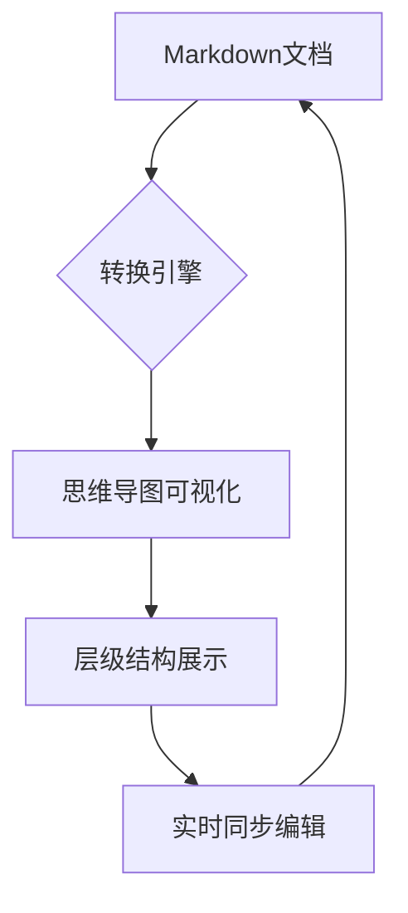
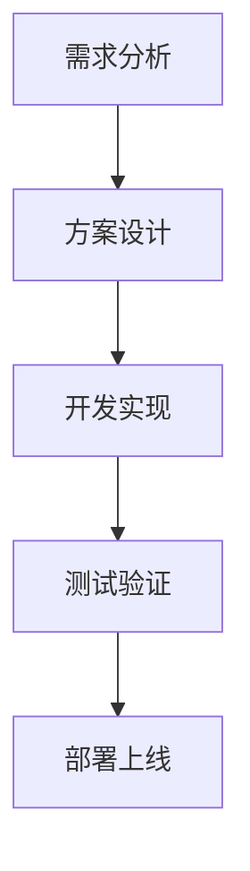

# ProcessOn：一站式可视化创作平台的全面解析

## 平台概览：重新定义在线绘图体验

**ProcessOn** 是一款功能强大的在线绘图工具，为用户提供从思维导图、流程图到专业图表的全方位可视化解决方案。作为云端协作平台，它打破了传统绘图软件的限制，让创作变得更加高效和便捷。

### 核心优势

- **云端存储**：随时随地访问和编辑文件
- **实时协作**：多人同时在线编辑，提升团队效率
- **模板丰富**：海量专业模板库，快速启动项目
- **跨平台支持**：Web端、移动端无缝衔接

---

## Markdown功能：文字与视觉的完美融合

ProcessOn 深度集成了 **Markdown编辑器**，让用户能够在绘图环境中享受纯文本写作的简洁与高效。

### Markdown核心功能特性

#### 1. 基础文本格式化

# 一级标题

## 二级标题

**粗体文本**
_斜体文本_
`代码块`

#### 2. 列表与表格

- 无序列表项
- 另一个列表项

1. 有序列表
2. 第二项

| 表头1 | 表头2 |
| ----- | ----- |
| 内容1 | 内容2 |

#### 3. 链接与引用

[ProcessOn官网](https://www.processon.com)

#### 4. 任务列表

- [x] 已完成任务
- [ ] 待完成任务

---

## 双向转换：Markdown与思维导图的智能桥梁

**ProcessOn最强大的功能之一**是实现了Markdown文档与思维导图之间的无缝双向转换。

### 转换机制解析

### 转换优势

- **智能识别标题层级**：自动将#号标题转换为思维导图节点
- **保持格式完整性**：列表、代码块等元素得到完美保留
- **双向实时同步**：任一端的修改都会即时反映到另一端
- **协作效率倍增**：文字工作者和视觉思考者可以协同工作

---

## 高级功能：Mermaid与LaTeX的专业支持

### Mermaid图表集成

ProcessOn 原生支持 **Mermaid语法**，让用户能够直接在Markdown中创建专业图表：

支持的Mermaid图表类型包括：

- 流程图（Flowchart）
- 时序图（Sequence Diagram）
- 甘特图（Gantt）
- 类图（Class Diagram）
- 状态图（State Diagram）
- ...

### LaTeX数学公式渲染

对于学术和技术文档，ProcessOn完美支持**LaTeX数学公式**：

$E = mc^2$

$\sum_{i=1}^n i = \frac{n(n+1)}{2}$

$\int_a^b f(x)dx = F(b) - F(a)$

---

## 应用场景与实践价值

### 教育领域

- **课程笔记整理**：Markdown记录，思维导图复习
- **学术论文写作**：LaTeX公式与可视化结合
- **项目规划**：Mermaid流程图辅助学习

### 企业协作

- **需求文档**：文字描述与流程图同步生成
- **技术方案**：代码片段与架构图并存
- **会议纪要**：实时转换为可视化会议图谱

### 个人知识管理

- **读书笔记**：结构化记录与思维导图回顾
- **学习计划**：任务列表与进度可视化
- **创意写作**：大纲思维导图与详细内容并行

---

### 发展前景

- **AI智能辅助**：自动生成图表和建议结构
- **更多格式支持**：扩展第三方图表库集成
- **移动端优化**：增强移动设备创作体验
- **生态建设**：插件市场和API开放平台

---

## 总结：重新定义创作边界

**ProcessOn不仅仅是一个绘图工具**，它是一个**全方位的可视化创作生态系统**。通过将Markdown的简洁性、思维导图的直观性、Mermaid的专业性和LaTeX的精确性完美融合，ProcessOn为不同领域的用户提供了前所未有的创作体验。

无论你是学生、教师、工程师、设计师还是管理者，ProcessOn都能帮助你**将想法快速转化为清晰的可视化表达**，真正实现了"思维可视化，创作无边界"的理念。

> **尝试ProcessOn，开启你的高效创作之旅！**
